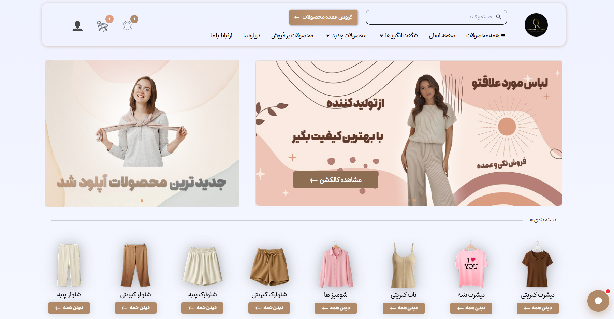
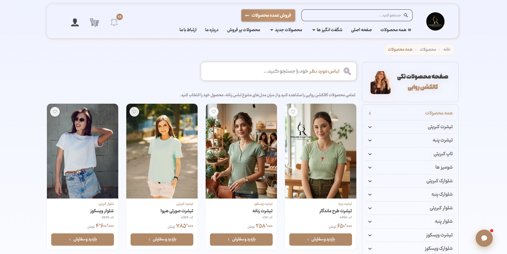
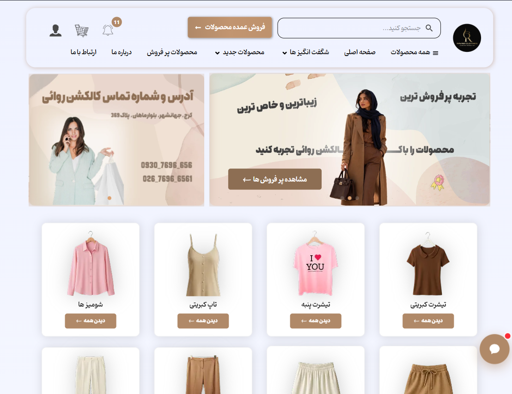
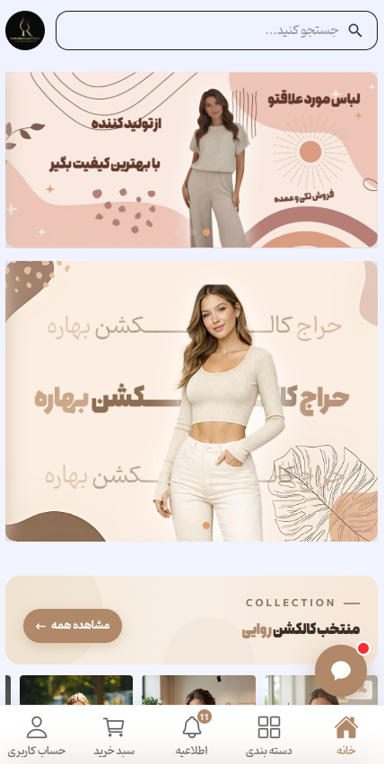

 

## 🌸 معرفی پروژه

**کالکشن روائی** یک فروشگاه آنلاین پوشاک است؛ با ظاهری نرم و گرم، چیدمان تمیز و تمرکز کامل روی خودِ محصول. هدف طراحی این بود که مشتری بدون حواس‌پرتی، لباس‌ها را ببیند، انتخاب کند و با خیال راحت خرید کند.

این پروژه یک **سفارش واقعی و فعال** است. من در تیم، **طراحی رابط و تجربه‌ی کاربری (UI/UX)** و **توسعه‌ی فرانت‌اند** آن را بر عهده داشتم.

> 🔒 **درباره‌ی این ریپازیتوری:** سایت برای یک کارفرمای واقعی ساخته شده و سورس‌کد آن منتشر نمی‌شود. این صفحه فقط برای **معرفی پروژه، نمایش خروجی نهایی و توضیح کار انجام‌شده** است.

 

## 🔗 لینک‌ها

| | |
|---|---|
| 🌐 **سایت زنده** | [ravaeiclothes.com](https://ravaeiclothes.com/) |
| 👤 **نقش من** | طراح UI/UX و توسعه‌دهنده‌ی فرانت‌اند, همکاری بک اند و سئو فنی |
| 🗓️ **وضعیت** | منتشرشده و فعال ✅ |

 

## 🖼️ تصاویر پروژه

صفحه‌ی محصولات — دسکتاپ

  

<table>
  <tr>
    <td width="50%"></td>
    <td width="50%"></td>
  </tr>
  <tr>
    <td align="center">نسخه لپ تاپ</td>
    <td align="center">نسخه‌ی موبایل</td>
  </tr>
</table>

 

## 🚀 امکانات

- **ویترین محصولات** با کارت‌های تمیز، تصویر بزرگ و اطلاعات ضروری
- **دسته‌بندی و مرور آسان** برای پیدا کردن سریع لباس مورد نظر
- **صفحه‌ی اختصاصی هر محصول** با گالری تصویر و جزئیات
- **سبد خرید و مسیر سفارش ساده**
- **طراحی کاملاً ریسپانسیو** و بهینه برای خرید با موبایل
- **پشتیبانی کامل از فارسی و راست‌به‌چپ (RTL)**
- **تم روشن و ملایم** با پالت کرم و صورتی که تصویر لباس‌ها را برجسته می‌کند
- **سئوی فنی (SEO)** و سرعت بارگذاری مناسب برای دیده‌شدن بهتر در گوگل

 

## 🎨 طراحی و هویت بصری

طراحی روی حس **لطافت و سادگی** بنا شده تا خود لباس‌ها مرکز توجه باشند.

| رنگ | کد | کاربرد |
|---|---|---|
|  قهوه‌ای روشن (اصلی) | `#B08968` | رنگ اصلی برند، دکمه‌ها و لینک‌ها |
|  سفید کرم | `#FBF6EE` | پس‌زمینه‌ی اصلی |
|  صورتی ملایم | `#F2D4D1` | بخش‌های تأکیدی و کارت‌ها |
|  بژ | `#E7D3BE` | جداکننده‌ها و زمینه‌های ثانویه |
|  قهوه‌ای تیره | `#6F5440` | متن و عنوان‌ها |

 

## 🧰 تکنولوژی‌ها

 <table> <tr> <td align="center" width="120"> <b>Next.js</b></td> <td align="center" width="120"> <b>TypeScript</b></td> <td align="center" width="120"> <b>Tailwind CSS</b></td> <td align="center" width="120"> <b>Framer Motion</b></td> <td align="center" width="120"> <b>Prisma</b></td> <td align="center" width="120"> <b>PostgreSQL</b></td> <td align="center" width="120"> <b>SEO</b></td> </tr> </table> 
  

 

## 🧩 سهم من در پروژه

1. **طراحی UI/UX**: چیدمان فروشگاه، سیستم رنگ و تایپوگرافی، تجربه‌ی خرید در موبایل
2. **توسعه‌ی فرانت‌اند** با Next.js (تخصص اصلی من)
3. **هماهنگی با بک‌اند** و اتصال رابط به داده‌های محصول و سفارش
4. **سئو و ساختار محتوا**
5. **تست و رفع باگ** پیش از انتشار
6. **نگهداری و به‌روزرسانی** پس از راه‌اندازی

 

## 📬 ارتباط با من

اگر نمونه‌کار بیشتری لازم دارید یا پروژه‌ای در ذهن دارید:

- 📧 [arshamghaderi369@gmail.com](mailto:arshamghaderi369@gmail.com)
- 🌐 دیگر نمونه‌کار: [وب پرشین آسیا](https://github.com/YOUR_USERNAME/webpersianasia-showcase)

 

© تمام حقوق این پروژه متعلق به کارفرمای آن است. سورس‌کد منتشر نشده است.

